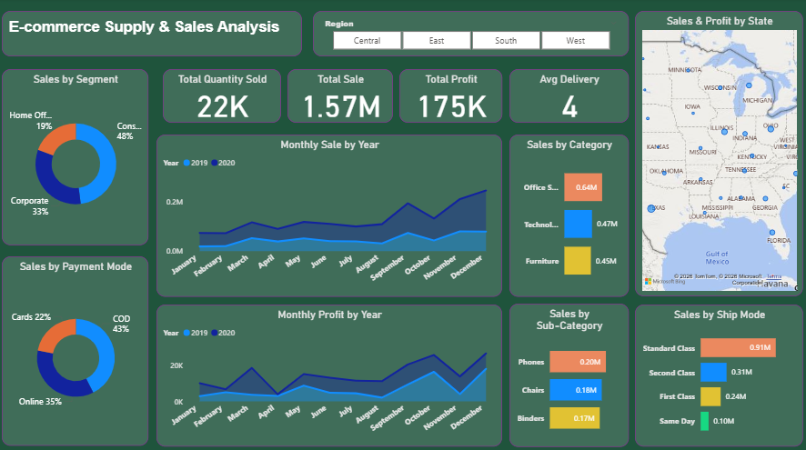

# Superstore Sales Analysis and Forecasting

## Project Overview
An interactive Power BI project focused on analyzing Superstore sales, profitability, customer segments, and regional performance. It also includes 15-day sales forecasting to support data-driven business decisions.

## Objectives
- Analyze sales and profit trends.
- Identify top-performing products and regions.
- Track key performance indicators (KPIs).
- Forecast sales for the next 15 days.
- Generate actionable business insights.

## Tools & Technologies
- **Power BI** – Data cleaning, dashboard development, and visualization 
- **SQL** – Data querying and analysis

## Dashboard Preview

### Sales Analysis

### Sales Forecasting

## Key Insights
- Consumer segment contributes the highest share of sales.
- Office Supplies leads the displayed product categories.
- California has the highest sales among the displayed states.
- Sales forecasting helps identify potential future trends.

## Files Included
- `Super Store Sale.pbix` – Power BI dashboard
- `SuperStore Sales DataSet.xlsx` – Excel dataset
- `SuperStore_Sales_Dataset.csv` – CSV dataset
- `Super Store Sale.pdf` – Dashboard report

## How to Use
1. Clone or download this repository.
2. Open `Super Store Sale.pbix` in Power BI Desktop.
3. Configure the data source if required.
4. Refresh the data and explore the dashboards.

## Author
**Muhammad Adnan**

[GitHub Profile](https://github.com/Muhammad-Adnan76)
